# DeepSeek-V4-Flash 的推理上下文并行系统设计

[返回专题目录](./README.md) · [下载 PDF](https://raw.githubusercontent.com/cuihangbin/cuihangbin/main/docs/deepseek-v4-flash-cp/DeepSeek-V4-Flash-CP.pdf)

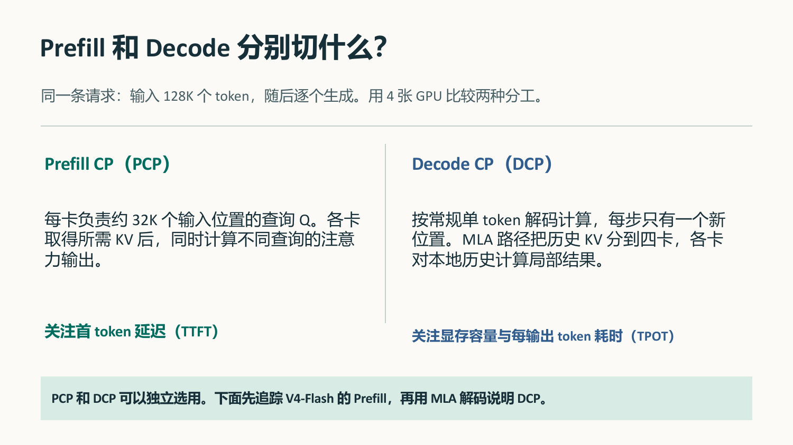

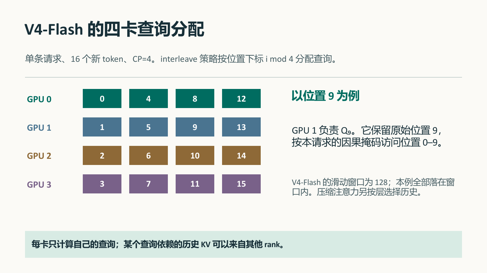

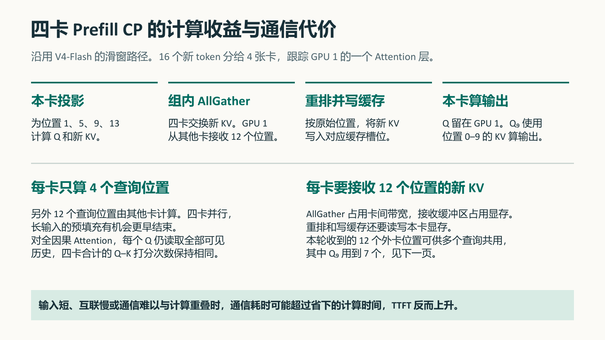

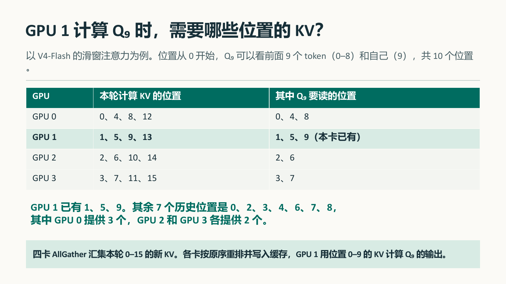

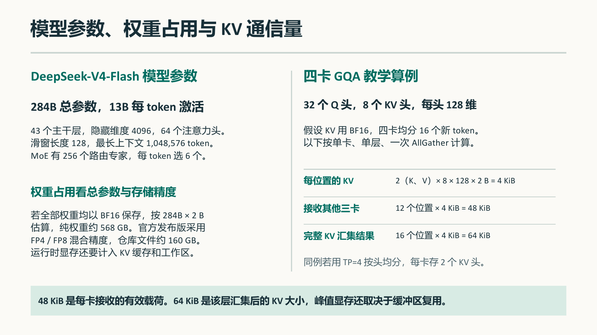

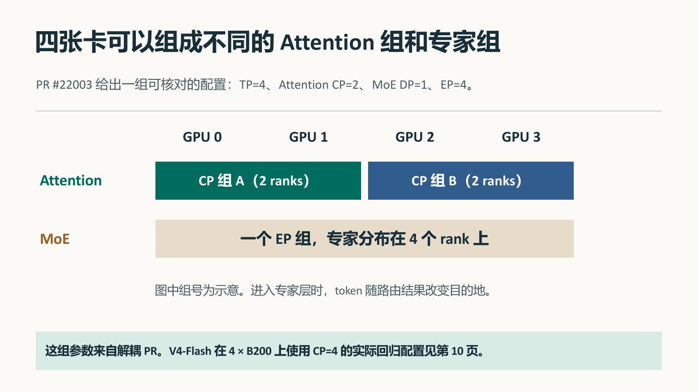

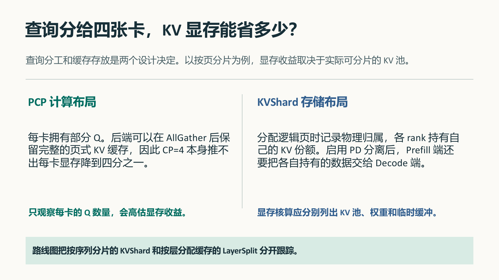

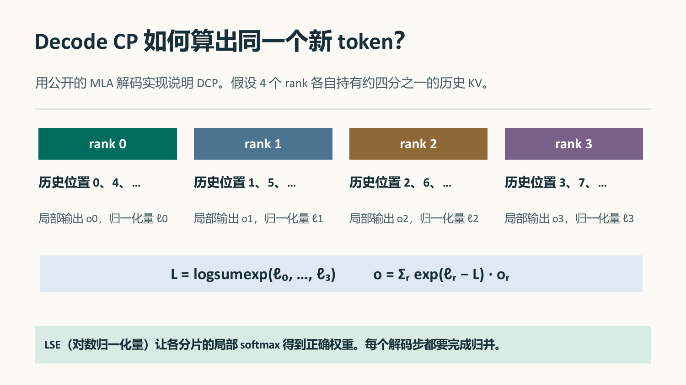

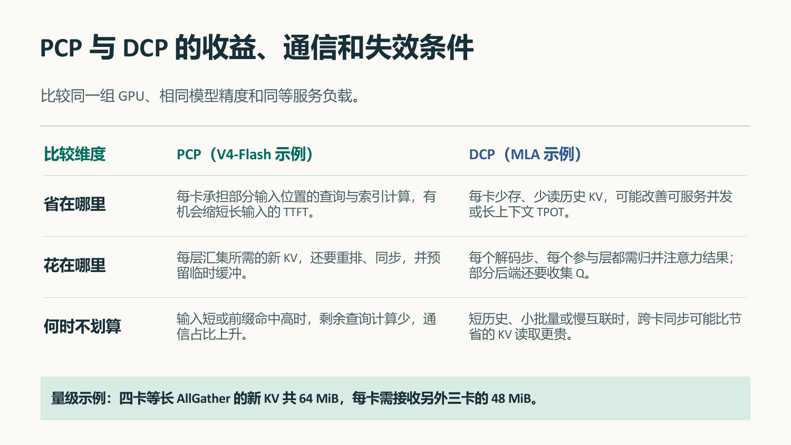

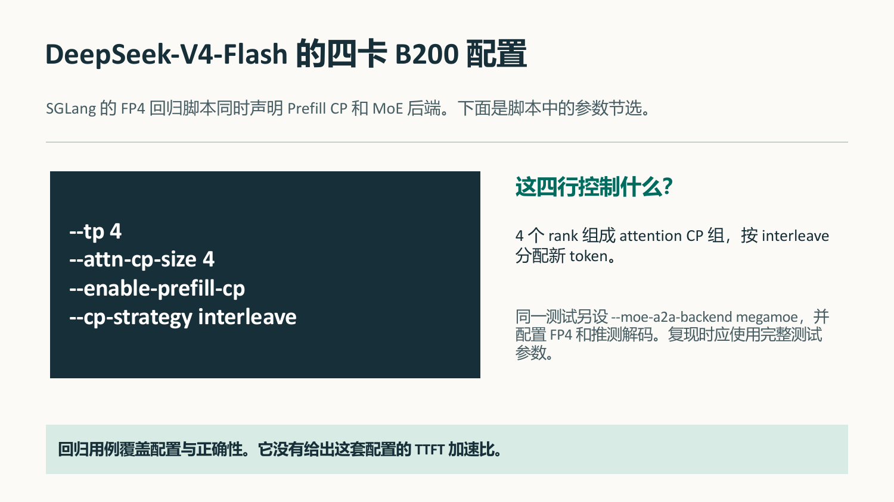

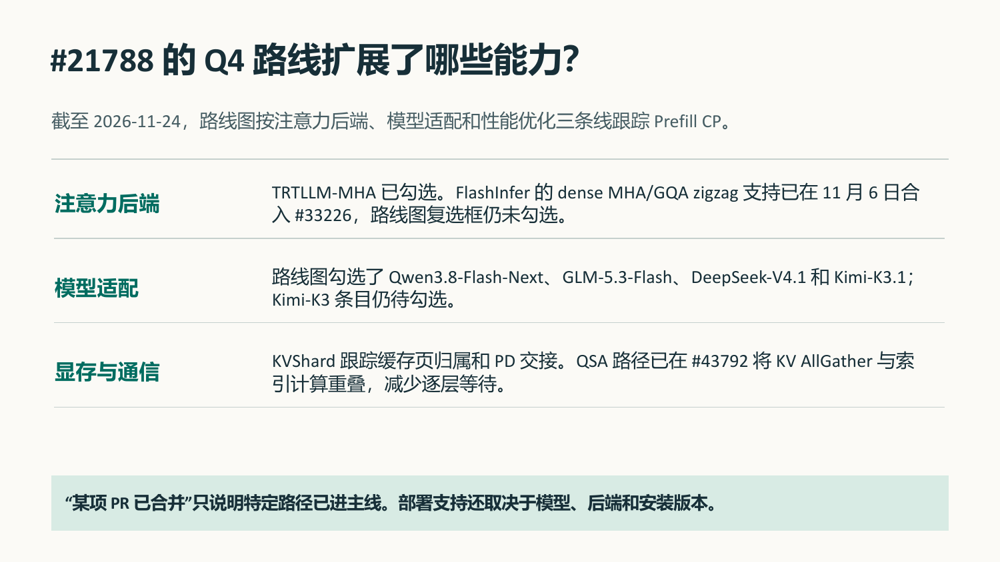

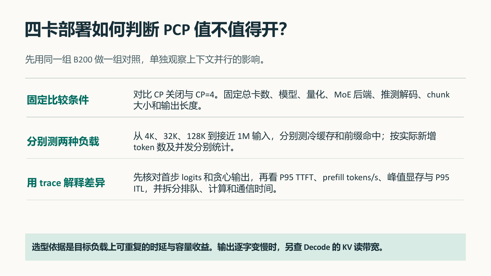
